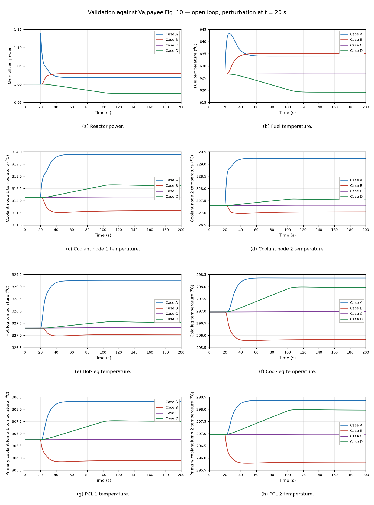

# OpenPWR

A non-linear pressurised water reactor plant model with a control testbed:
Li's two-point axial core (point kinetics and iodine/xenon per axial half)
transplanted into Vajpayee's plant skeleton. It trims to an equilibrium,
integrates open- or closed-loop, and lets you plug in your own controllers,
continuous or discrete-time. `validation/validate_vajpayee.py` checks its
open-loop responses against Vajpayee's Figs. 10 and 11.

It exists to study **axial offset control**: keeping the vertical power
distribution flat while the plant follows load. 53 states, 8 inputs.

Start with [docs/QUICKSTART.md](docs/QUICKSTART.md).

## Install

Python 3.9 or later.

```bash
pip install -r requirements.txt
```

The scripts and the notebook run straight from a clone. To import `pwr_plant`
from anywhere else, install it in editable mode:

```bash
pip install -e .
```

## Quick start

```python
from pwr_plant import Plant, turbine_leading, ramp

loop = turbine_leading(Plant(), demand=ramp(1.0, 0.5, hold=4*3600))
res  = loop.run(12 * 3600)              # 12 h load-follow, a few seconds
res.df.plot(x="t_h", y=["demand", "Pn", "P_tur"])
print(res.summary())
```

`res.df` is a pandas DataFrame with every state, derived signal and actuator
as a named column. [notebooks/demo.ipynb](notebooks/demo.ipynb) walks through
writing and tuning controllers.

## Check it works

```bash
python tests/smoke_test.py
```

13 checks, a few seconds. Then the validation against [V]'s figures:

```bash
python validation/validate_vajpayee.py
```

On the shipped defaults the direction of change agrees in 40 of 40 comparisons.
That score compares final steady-state values only, by sign; it says nothing
about overshoot, settling or ringing.



## Limitations

Read [docs/VALIDATION_AND_CONSTRAINTS.md](docs/VALIDATION_AND_CONSTRAINTS.md)
§6 before quoting any result.

- **No safety limits.** There is no trip logic, DNBR, peaking factor or rod
  insertion limit, so the model cannot show that a controller respects one.
- **No decay heat**, so shutdowns, trips and large downpower transients are
  wrong in the tail.
- **The axial xenon mode is unstable at the default parameters**: the
  linearisation at 100 % has a pair at +5.67e-5 ± 4.13e-5 /s (doubling 3.4 h,
  period 42 h). Runs longer than a few hours need an axial offset controller.
- **Two parameters come from neither source paper**: `F_couple` and
  `rho_xe_full`. The second decides whether that instability exists at all.
  See [docs/SENSITIVITY.md](docs/SENSITIVITY.md).
- **It is a hybrid, not any real plant.** The core equations are Li's; every
  number in them is Vajpayee's. Quote behaviours and comparisons, not absolute
  values.
- **The two-point core has never been checked against Li's own results.** Only
  the plant around it is validated.
- No feedwater or steam generator level control, boron, steam dump or pump
  coastdown.

## Layout

```
OpenPWR/
├── README.md
├── CLAUDE.md                     context for AI coding agents
├── LICENSE
├── CITATION.cff
├── pyproject.toml
├── requirements.txt
├── pwr_plant/
│   ├── __init__.py
│   └── model.py                  the whole model and control testbed
├── notebooks/
│   └── demo.ipynb
├── validation/
│   ├── validate_vajpayee.py      open-loop responses against [V] Figs. 10-11
│   ├── compare_printed.py        shipped defaults against [V] as printed
│   └── figures/
├── studies/
│   ├── sensitivity.py            sweep of the two free parameters
│   ├── sensitivity_results.csv
│   └── figures/
├── docs/
│   ├── QUICKSTART.md
│   ├── API_REFERENCE.md
│   ├── MORE_CONTROL_EXAMPLES.md
│   ├── VALIDATION_AND_CONSTRAINTS.md
│   ├── SENSITIVITY.md
│   └── FAQ.md
├── presentations/
└── tests/
    └── smoke_test.py
```

## References

- **[V]** Vajpayee, V., Becerra, V., Bausch, N., Deng, J., Shimjith, S. R.,
  Arul, A. J. (2020). Dynamic modelling, simulation, and control design of a
  pressurized water-type nuclear power plant. *Nuclear Engineering and Design*
  370, 110901. [doi:10.1016/j.nucengdes.2020.110901](https://doi.org/10.1016/j.nucengdes.2020.110901).
  Supplies the plant and every numerical parameter.
- **[L]** Li, G. (2014). Modeling and LQG/LTR control for power and axial power
  difference of load-follow PWR core. *Annals of Nuclear Energy* 68, 193–203.
  [doi:10.1016/j.anucene.2014.01.022](https://doi.org/10.1016/j.anucene.2014.01.022).
  Supplies the two-point axial core equations.
- **[K]** Kerlin, T. W., Katz, E. M., Thakkar, J. G., Strange, J. E. (1976).
  Theoretical and experimental dynamic analysis of the H. B. Robinson nuclear
  plant. *Nuclear Technology* 30(3), 299–316.
  [doi:10.13182/NT76-A31645](https://doi.org/10.13182/NT76-A31645).

## Licence

MIT. See [LICENSE](LICENSE).
