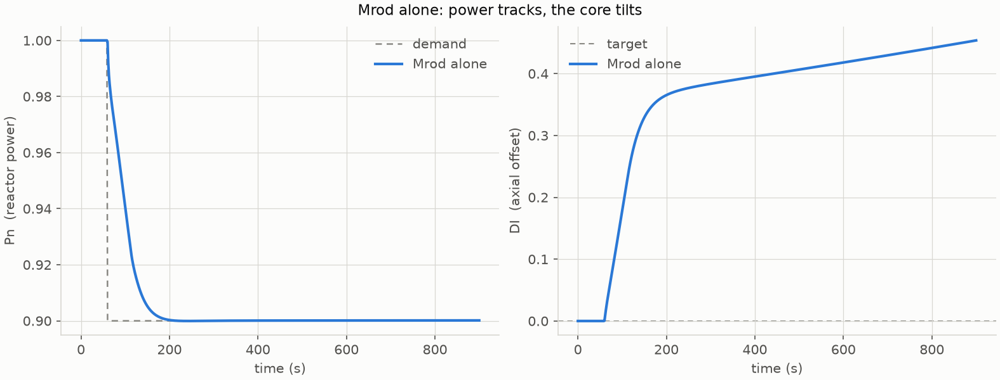
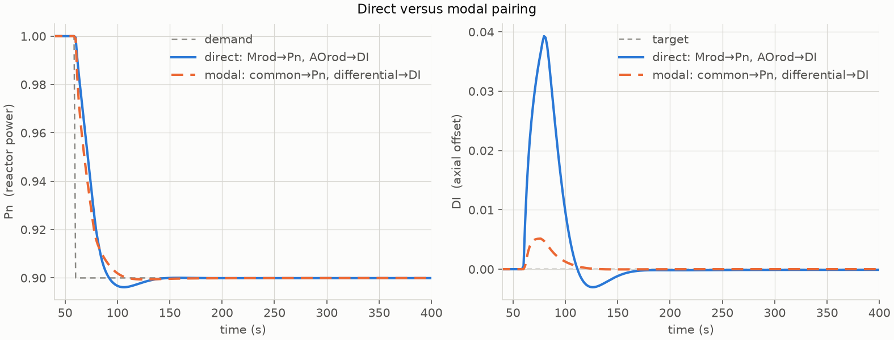
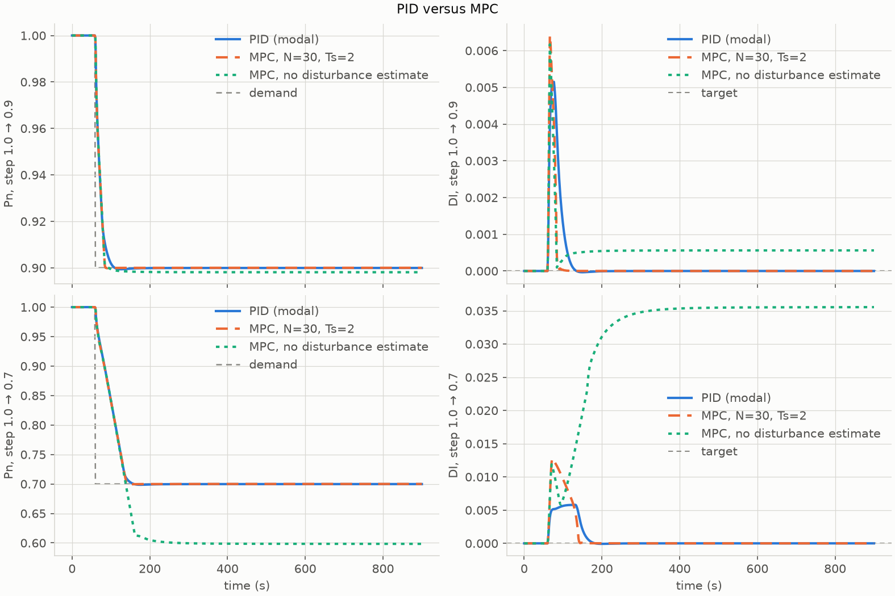

# Control examples

Worked examples for comparing control algorithms on `pwr_plant/model.py`.
Every number below is measured, not asserted — paste the snippet and you get it.

**Start with `QUICKSTART.md`.** It covers the plant, trim, step responses, and
P / PI / PID from nothing, and this page assumes all of it. What follows is the
multivariable half of the problem — the part a single loop cannot reach.

| # | example | what it teaches |
|---|---|---|
| 1 | Mrod alone | one group, and what it leaves behind |
| 2 | AOrod alone | the second controlled variable |
| 3 | 2×2 PID on both rods | pairing, and a second integrator |
| 4 | constrained MPC on both rods | prediction and limits |
| 5 | PID vs MPC | a fair comparison, and where each breaks |
| 6 | feedforward and cascade | two structures beyond a single loop |

Common preamble for every example:

```python
import numpy as np
from pwr_plant import *

plant = Plant()
x0, u0, res = trim(plant, 1.0)
dem = step(1.0, 0.9, t_step=60.0)      # the demand every example uses
```

Every loop below also carries `ValvePI()`, the steam-pressure controller built
in `QUICKSTART.md` section 11. Paste that class in as well.

---
## Plotting setup

Every figure below uses this style module. Save it as `viz.py` beside your
script. The three series colours are a validated categorical palette — worst
all-pairs colour-blind separation ΔE 9.2, normal-vision ΔE 24.0 — assigned in
fixed order so a series keeps its colour when you add or drop one.

```python
# viz.py
import matplotlib; matplotlib.use("Agg")
import matplotlib.pyplot as plt

SERIES = ["#2a78d6", "#eb6834", "#1baf7a"]                        # blue, orange, aqua
RAMP   = ["#bdd7f2", "#8ab8e8", "#4a94dd", "#2a78d6", "#17508f"]  # sequential blue
INK, INK2, GRID, REF = "#0b0b0b", "#52514e", "#d8d7d2", "#8a8984"

plt.rcParams.update({
    "figure.facecolor": "#fcfcfb", "axes.facecolor": "#fcfcfb",
    "axes.edgecolor": GRID, "axes.labelcolor": INK2, "axes.titlecolor": INK,
    "axes.spines.top": False, "axes.spines.right": False,
    "xtick.color": INK2, "ytick.color": INK2,
    "grid.color": GRID, "grid.linewidth": 0.6, "axes.grid": True,
    "legend.frameon": False, "legend.labelcolor": INK2,
    "lines.linewidth": 2.0, "savefig.dpi": 130,
    "figure.constrained_layout.use": True,
})

def setpoint(ax, y, label=None):
    """Reference line in neutral ink — never a series colour."""
    ax.axhline(y, color=REF, lw=1.0, ls=(0, (4, 3)), zorder=0, label=label)

def finish(ax, ylabel, xlabel="time (s)", legend=True):
    ax.set_ylabel(ylabel); ax.set_xlabel(xlabel)
    if legend and ax.get_legend_handles_labels()[0]:
        ax.legend(loc="best")
```

Four rules these encode, worth keeping whatever you plot:

- **Never two y-scales on one axis.** `Pn` ≈ 1 and `Tavg` ≈ 316 do not belong on
  the same plot. Use separate panels.
- **Setpoints and demand are not series.** They go in neutral grey, dashed, so
  colour means "controller" and nothing else.
- **Fixed colour order.** Blue is always the first controller, orange the second.
  Dropping a case must not repaint the survivors.
- **Where two traces coincide, change the linestyle.** Identity is never carried
  by colour alone — you will see this in example 5.

---

## Reference: the gain matrix

The measured step gain of each actuator, which the examples below refer back to:
the change 300 s after a step of +5 steps/min on a rod group or +0.05 on the valve.
`QUICKSTART.md` sections 6 and 7 derive these; they are repeated here because
every pairing argument on this page rests on them.

```
input        dPn       dDI     dTavg       dps
vrod_M   +0.0131   -0.0986    +1.854   +0.0831
vrod_AO  +0.0264   +0.0854    +1.622   +0.1680
utg      +0.0293   -0.0107    -0.469   -0.1441
```

- **Both rods raise power; they move `DI` in opposite directions.** That is the
  common/differential split, and it is why two loops can share one pair of rods.
- **`utg` moves `ps` hard and `DI` barely.** The valve's natural partner is steam
  pressure, not power.

Do not use `dc_gain(A, B, C, D)` for the rods. Rod inputs are *speeds*, so they
integrate; `A` is singular in those directions and the pseudo-inverse returns a
number that looks meaningful and isn't. Measured step responses are the honest
version.

---

## 1. Mrod alone

```python
class MrodP(Controller):
    name = "mrod_p"
    def __init__(self, kp=3000., v_max=72.):
        self.kp, self.v_max = kp, v_max
    def update(self, t, sig, xc, u, ctx):
        v = float(np.clip(self.kp*(ctx.demand(t) - sig["Pn"]), -self.v_max, self.v_max))
        u[IU["vrod_M"]] += v
        return EMPTY

r = ClosedLoop(plant, [GridDemand(), MrodP(), ValvePI()],
               demand=dem, x0=x0, u0=u0).run(900, n_out=600)
```

```
Pn_end 0.9001  (demand 0.90)      |DI|max 0.45368   DI_end +0.45368
```

Power tracks to four figures with **no integrator state**. The rod drive already
integrates — `dρrod/dt = G·vrod/60` — so a proportional law on rod *speed* is
integral action on power. That is why none of the rod controllers here declare
states for the proportional path.

But `DI` has run to **+0.45** and is still climbing. Mrod acts on the bottom
half only, so holding power with one group tilts the core — and the axial xenon
mode then amplifies the tilt rather than decaying it. Left alone the run
saturates near |DI| ≈ 0.94; it diverges in *either* direction, so the sign here
is set by which half the rod is in, not by the instability. That is what
example 2 is for.



Plot both outputs or you will not see the problem. The left panel says the
controller works; the right panel says it has tilted the core by 0.45 and is
not finished.

Note `+=`, not `=`. Rod commands accumulate so two loops can share the groups.
Use `=` and you silently delete the other controller.

---

## 2. AOrod alone

```python
class AOrodP(Controller):
    name = "aorod_p"
    def __init__(self, kp=2000., v_max=72., target=0.0):
        self.kp, self.v_max, self.target = kp, v_max, target
    def update(self, t, sig, xc, u, ctx):
        v = float(np.clip(self.kp*(self.target - sig["DI"]), -self.v_max, self.v_max))
        u[IU["vrod_AO"]] += v
        return EMPTY

r_ao   = ClosedLoop(plant, [GridDemand(), AOrodP(), ValvePI()],
                    demand=dem, x0=x0, u0=u0).run(900, n_out=600)
r_both = ClosedLoop(plant, [GridDemand(), MrodP(), AOrodP(), ValvePI()],
                    demand=dem, x0=x0, u0=u0).run(900, n_out=600)
```

```
AOrod only  -> DI       Pn_end 1.0000   |DI|max 0.00000   DI_end +0.00000
naive both  -> Pn, DI   Pn_end 0.8999   |DI|max 0.03928   DI_end -0.00009
```

**Sign again:** the error is `target − DI`. From the gain matrix above,
`vrod_AO` moves `DI` *positive*, so a positive gain on `target − DI` is negative
feedback. Write it as `DI − target` and the loop is positive feedback: power
runs to 3.5 with no error raised.

With AOrod alone nothing follows the demand, so power stays at 1.0 and `DI`
never moves. Run both groups together and you get power tracking *and* `DI`
held — the naive pairing works. Example 3 asks whether it's the best one.

---

## 3. 2×2 PID on both rods

Two pairings are available. Direct: Mrod→power, AOrod→offset. Modal: common
mode→power, differential→offset.

```python
class RodPID2x2(Controller):
    name = "rod_pid"; states = ("Ip", "Id", "yp", "yd")
    def __init__(self, kp=(3000., 2000.), ki=(0., 0.), kd=(0., 0.),
                 Tf=5.0, modal=True, v_max=72.):
        self.kp, self.ki, self.kd = kp, ki, kd
        self.Tf, self.modal, self.v_max = Tf, modal, v_max
    def initialize(self, ctx):
        return np.array([0., 0., ctx.sig0["Pn"], ctx.sig0["DI"]])
    def update(self, t, sig, xc, u, ctx):
        ep = ctx.demand(t) - sig["Pn"]
        ed = 0.0 - sig["DI"]                       # note the sign, as in example 2
        dyp = (sig["Pn"] - xc[2]) / self.Tf
        dyd = (sig["DI"] - xc[3]) / self.Tf
        cp = float(np.clip(self.kp[0]*ep + self.ki[0]*xc[0] - self.kd[0]*dyp,
                           -self.v_max, self.v_max))
        cd = float(np.clip(self.kp[1]*ed + self.ki[1]*xc[1] - self.kd[1]*dyd,
                           -self.v_max, self.v_max))
        if self.modal:
            vm, va = cp - cd, cp + cd
            k = min(1.0, self.v_max / max(abs(vm), abs(va), 1e-12))
            u[IU["vrod_M"]]  += k * vm
            u[IU["vrod_AO"]] += k * va
        else:
            u[IU["vrod_M"]]  += cp
            u[IU["vrod_AO"]] += cd
        return np.array([ep, ed, dyp, dyd])

runs = {name: ClosedLoop(plant, [GridDemand(), RodPID2x2(modal=m), ValvePI()],
                         demand=dem, x0=x0, u0=u0).run(900, n_out=600)
        for name, m in (("groups", False), ("modal", True))}
```

Pairing, with `ki = 0`:

```
groups   IAE_Pn 1.4557   |DI|max 0.03928   Pn_end 0.8999   DI_end -0.00009   rodmax 72.0
modal    IAE_Pn 1.2417   |DI|max 0.00515   Pn_end 0.8999   DI_end -0.00000   rodmax 72.0
```

Modal is **7.6× tighter on axial offset** and 15% better on power tracking.



Both pairings track power closely — the difference is almost entirely in the
right panel. Set the x-limits to the transient (`ax.set_xlim(40, 400)`); the remaining
500 s is flat and only shrinks what you care about. The reason
is in the gain matrix above: AOrod moves `DI` (+0.085) *more* than it moves power (+0.026), so
the direct pairing has its two loops fighting through the cross-term. The modal
transform diagonalises it.

Now the integral gain, on the modal pairing:

```
ki_power    IAE_Pn    |DI|max   Pn_end
     0.0     1.2417   0.00515   0.8999
     1.0     1.4744   0.00515   0.8997
     5.0     1.9471   0.00515   0.8995
    20.0     2.0747   0.00517   0.9000
```

**Monotonically worse, and it buys nothing** — there was no offset to remove.
The drive already integrates, so adding `ki` stacks a second integrator on a
plant with transport delay. The "PID" that actually works on these rods is
P with optional filtered D.

Note the scaling in the modal branch. The drive limit is **per rod**, so clipping
each mode at 72 and then summing lets the commanded rod speed reach 144. Scale
the pair instead.

---

## 4. Constrained MPC on both rods

### What a QP is, and whether you need one

MPC minimises a quadratic cost over a horizon of future moves. Unconstrained,
that minimisation is a single matrix solve — numpy only. **Constraints** (rod
speed ≤ 72 spm) turn it into a search, and a *quadratic program* solver does
that search.

You don't need a dedicated QP package here. When the only constraints are bounds
on the moves, the problem is a box-constrained least squares, and
`scipy.optimize.lsq_linear` solves exactly that. Real constraint handling, no new
dependency. For *output* constraints (a hard AO band) you would need `osqp` or
similar.

```python
from scipy.optimize import lsq_linear
from scipy.signal import cont2discrete

class RodMPC(Controller):
    name = "rod_mpc"
    def __init__(self, N=30, Ts=2.0, q=(1.0, 3.0), r=1e-9, v_max=72.0,
                 outputs=("Pn", "DI"), offset_free=True):
        self.N, self.Ts, self.q, self.r = N, Ts, np.array(q, float), r
        self.v_max, self.outputs, self.offset_free = v_max, outputs, offset_free

    def initialize(self, ctx):
        A, B, C, D, S = linearize(ctx.plant, ctx.x0, ctx.u0)
        iu = [IU["vrod_M"], IU["vrod_AO"]]
        iy = [OUTPUT_NAMES.index(o) for o in self.outputs]
        Ad, Bd, Cd, _, _ = cont2discrete((A, B[:, iu], C[iy, :], 0), self.Ts, method="zoh")
        self.Ad, self.Bd, self.Cd, self.S = Ad, Bd, Cd, S
        self.nu, self.ny, self.nx = Bd.shape[1], Cd.shape[0], Ad.shape[0]
        N = self.N
        Psi   = np.zeros((N*self.ny, self.nx))        # effect of the current state
        Theta = np.zeros((N*self.ny, N*self.nu))      # effect of the planned moves
        Phi   = np.zeros((N*self.ny, self.nx))        # effect of a constant disturbance
        Ak, Sk = np.eye(self.nx), np.zeros((self.nx, self.nx))
        for k in range(N):
            Sk = Sk + Ak                               # I + Ad + ... + Ad^k
            Ak = Ak @ Ad                               # Ad^(k+1)
            Psi[k*self.ny:(k+1)*self.ny, :] = Cd @ Ak
            Phi[k*self.ny:(k+1)*self.ny, :] = Cd @ Sk
            for j in range(k+1):
                Theta[k*self.ny:(k+1)*self.ny, j*self.nu:(j+1)*self.nu] = \
                    Cd @ np.linalg.matrix_power(Ad, k-j) @ Bd
        self.Psi, self.Theta, self.Phi = Psi, Theta, Phi
        self.Wy = np.diag(np.tile(np.sqrt(self.q), N))
        self.Amat = np.vstack([self.Wy @ Theta, np.sqrt(self.r)*np.eye(N*self.nu)])
        self.lo = np.full(N*self.nu, -self.v_max)
        self.hi = np.full(N*self.nu, +self.v_max)
        self.z_prev = self.v_prev = None               # last sample's state and move
        return EMPTY

    def update(self, t, sig, xc, u, ctx):
        z = (ctx.x - ctx.x0) / self.S                   # scaled deviation state
        # Disturbance estimate: whatever the model failed to predict over the
        # last sample.  It is the footprint of every input the model does not
        # contain (the valve, the grid demand) and of linearisation error.
        e = np.zeros(self.nx)
        if self.offset_free and self.z_prev is not None:
            e = z - (self.Ad @ self.z_prev + self.Bd @ self.v_prev)
        tgt = np.array([ctx.demand(t) - ctx.sig0["Pn"], 0.0 - ctx.sig0["DI"]])
        ref = np.tile(tgt, self.N)
        free = self.Psi @ z + self.Phi @ e              # what happens with no moves
        b = np.concatenate([self.Wy @ (ref - free), np.zeros(self.N*self.nu)])
        sol = lsq_linear(self.Amat, b, bounds=(self.lo, self.hi),
                         lsmr_tol="auto", max_iter=40)
        v = sol.x[:self.nu]                             # receding horizon
        self.z_prev, self.v_prev = z, v.copy()
        u[IU["vrod_M"]]  += float(v[0])
        u[IU["vrod_AO"]] += float(v[1])
        return EMPTY
```

Two features of the model make this a *simple* MPC rather than a project:

- **No observer needed.** `ctx.x` is the full 53-state vector, so the controller
  does full-state feedback. A real plant would need a Kalman filter here.
- **No sampled-time plumbing needed.** Setting `Ts` makes it zero-order-hold
  automatically: `update` fires once per sample and its output is held in
  between.

**Always scale.** `linearize` returns the scaling vector `S`; the states span
seven decades and the condensed matrices are hopeless without it.

### The disturbance estimate

The prediction model contains only the two rods. In the loop, a separate
controller is moving the steam valve the whole time, and the model has never
heard of it. Without a correction the MPC plans against a plant whose valve it
believes is at trim, and settles where its *predicted* error is zero rather than
where the real one is: 0.8981 instead of 0.9000 on a 10 % step. Hold the valve
fixed and that offset disappears completely, which is how we know the valve is
the cause and not the move penalty or the linearisation.

`e` is the fix. At each sample it is the difference between the state the plant
actually reached and the state the model predicted one sample ago. That gap is
the footprint of everything the model leaves out, whichever input caused it.
The controller assumes it persists over the horizon (`Phi @ e`) and plans
around it. Once the plant settles, the prediction is exact and the offset is
gone. `offset_free=False` switches it off, to see the difference.

`z_prev` and `v_prev` are ordinary attributes. That is legal only because the
controller is sampled, so `update` runs exactly once per sample.

### Tuning

Same demand as example 3, with `RodMPC(N, Ts, r)` in place of the PID plus
`PressurizerLevelPI()` (example 5 explains why that is mandatory),
`run(900, n_out=600)`:

```
 N   Ts      r        IAE    |DI|max   Pn_end   runtime
20  5.0   1e-06    1.8895    0.00154   0.8999     1.2 s
20  5.0   1e-08    1.1151    0.00544   0.9000     1.2 s
20  2.0   1e-08    1.0513    0.00619   0.9000     4.6 s
60  2.0   1e-09    1.0458    0.00641   0.9000     4.3 s
```

All four reach the target. The move penalty `r` is the trade that is left: the
heavily penalised first row moves the rods least (peak 69 spm, never on the
stop) and holds `DI` four times tighter, at the cost of slower power tracking.
A longer horizon buys almost nothing here: 20 steps and 60 steps differ in the
fourth decimal.

---

## 5. PID vs MPC

Same plant, same valve loop, same demand. `PID` is the modal 2×2 from example 3;
`MPC` is `N=30, Ts=2`. Each run is 900 s, scored with `score()` below.

Both loops here also carry `PressurizerLevelPI()`, and it is **load-bearing, not
decoration.** Surge is an input (`Config.pzr_surge=False`), so with `mdot_sur`
pinned at zero nothing moves mass into or out of the pressurizer. A rod
transient at the 72 spm drive limit expands the coolant faster than the
pressurizer can accommodate, the level state `lw` goes non-physical, and the run
dies inside the solver with `array must not contain infs or NaNs` — no mention of
the pressurizer anywhere in the traceback. Close the level loop, or command
`mdot_sur` yourself, before running anything aggressive. The PID cases survive
without it only because they are gentler.

**Small step, 1.0 → 0.9:**

```
                      IAE      |DI|max   Pn_end   rodmax   travel   runtime
PID                1.2417      0.00515   0.8999     72.0    148.1     0.5 s
MPC                1.0459      0.00641   0.9000     72.0    151.5     2.8 s
MPC, no estimate   2.5315      0.00617   0.8981     72.0    149.8     3.3 s
```

**Large step, 1.0 → 0.7:**

```
                      IAE      |DI|max   Pn_end   rodmax   travel   runtime
PID               11.7814      0.00579   0.6998     72.0    152.3     0.6 s
MPC               11.4429      0.01276   0.7000     72.0    155.9     3.2 s
MPC, no estimate  86.5989      0.03555   0.5984     72.0    169.1     4.2 s
```

"MPC, no estimate" is `RodMPC(offset_free=False)`.

With the disturbance estimate the two are close, and they win on different
outputs: MPC tracks power slightly better on both steps, PID holds `DI` tighter
on both (by a factor of two on the large step) and runs about five times
faster. Without the estimate MPC loses badly, for two separate reasons:



Small multiples: rows are the two step sizes, columns the two controlled
outputs. Same colour for the same controller across all four panels, so the eye
can carry identity between them.

**The model does not contain the valve.** On the small step the uncorrected MPC
settles at 0.8981 instead of 0.9000. The valve controller has closed the valve
to about 0.90 of trim and the prediction still assumes it is at trim (example
4). With the valve held fixed the same controller lands on 0.9000.

**The prediction model is linearized at 100% power.** CP8 measures the linear
validity envelope at about a 12% step for 5% error. A 30% step is far outside it,
so the uncorrected MPC confidently drives to where its model says 0.70 is and
lands at 0.60. PID uses no model and doesn't care.

The disturbance estimate removes both, because it does not care where a
prediction error comes from. It lands on 0.7000 with a model that is still
linearised at 100 %. Re-linearizing per operating point (the CP9 setpoint
family is exactly that input) would improve the transient further.

**Neither controller is clearly better here.** MPC's advantages aren't
exercised by this problem. The 2×2 rod problem is perfectly
decoupled in modal coordinates (off-diagonal/diagonal = 0.0000 in the modal `C·A·B`),
has no active output constraints, and has one dominant timescale. Those are the
conditions under which a well-tuned PID is hard to beat.

Where MPC should win here, and what to try next:

- **Hard output constraints.** The AO band `|DI| ≤ 0.03` is currently a dead-band
  hack. In MPC it is a row in the QP — but output constraints need a real QP
  solver (`osqp`), not `lsq_linear`.
- **Preview.** Grid load schedules are known in advance. No PID arrangement can
  use that; MPC gets it free by putting the future demand into `ref`.
- **Long-horizon xenon.** The axial mode is unstable with a doubling time of
  hours (CP8 finds a right-half-plane pair). A 60 s horizon cannot see it. A
  two-layer scheme — fast MPC on power, slow outer loop on offset — is the
  realistic structure.

---

## Making the comparison fair

The metrics used above, and why:

```python
def score(r):
    t  = r.df['t'].to_numpy()
    ep = r['Pn'] - r.df['demand'].to_numpy()
    return dict(
        iae    = float(np.trapezoid(np.abs(ep), t)),              # tracking
        dimax  = float(np.abs(r['DI']).max()),                    # the other output
        offset = float(ep[-1]),                                   # does it close?
        rodmax = float(max(np.abs(r.df['u_vrod_M']).max(),
                           np.abs(r.df['u_vrod_AO']).max())),     # saturation
        travel = float(np.abs(np.diff(r.df['u_vrod_M'].to_numpy())).sum()),
    )
```

Four rules that keep a comparison honest:

- **Same trim point.** Pass `x0=x0, u0=u0` to every `ClosedLoop` so none of them
  starts from a different equilibrium — and it skips the 0.6 s trim each time.
- **Report actuator effort, not just error.** `rodmax` tells you whether the
  drive limit was active; `travel` tells you how much wear the controller asks
  for. A controller that wins on IAE by saturating the rods hasn't won.
- **Report both outputs.** A power controller that looks excellent while `DI`
  runs to 0.45 and climbing (example 1) is not excellent.
- **Report runtime.** 0.6 s against 3.2 s is a real difference if you intend to
  run a thousand scenarios.

---

## 6. Beyond one loop: feedforward and cascade

Both are possible, and the code for both is below.

(MPC is in `QUICKSTART.md` section 17, which builds a thirty-line version and
measures it. Example 4 above is the two-input constrained case.)

### What the architecture allows

| structure | how to write it |
|---|---|
| **feedforward** | `ctx.demand(t)` may be called at **any** `t`, including the future. `GridDemand` and `ValveOnDemand` already do this. For *disturbance* feedforward, read the disturbance from `u` and add a term to the actuator. |
| **cascade** | **One** `Controller` containing both loops, with every integrator declared in `states`. |

> **Do not pass a setpoint between two controllers through an attribute.** In
> continuous mode the solver rejects and re-takes steps, so an attribute written
> during a rejected step is garbage. Either keep the cascade inside one
> controller, or sample it.

### Feedforward — it works, and the sign is not obvious

Feed-water temperature is measurable and enters through the steam generator, so
its effect can be cancelled at the valve *before* the shaft responds. A 15 °C
drop at t = 100 s, on this rig (`FeedwaterDrop` and `GovernorWithFF` are in the
code at the end of the section):

```python
def speed_case(gov, t_end=1200.0):
    """Feed-water drop against whatever `gov` does with the valve."""
    ctls = [GridDemand(), FeedwaterDrop(), gov, RodsOnTavg(),
            AxialOffsetBand(), PressurizerHeaterPI()]
    return ClosedLoop(plant, ctls, demand=lambda t: 1.0,
                      x0=x0, u0=u0).run(t_end, n_out=1200)

r = speed_case(GovernorWithFF(kff=-0.002))
```

Peak and IAE are of `w_tur - 60` over the 1200 s run:

| `kff` | peak \|Δω\| (Hz) | IAE speed |
|---|---|---|
| 0 (plain governor) | 0.1322 | 8.151 |
| −0.001 | 0.0845 | 4.800 |
| **−0.002** | **0.0465** | **2.539** |
| −0.0025 | 0.0403 | 2.768 |
| −0.005 | 0.1701 | 10.457 |

Peak excursion falls **2.8×**. The gain is **negative**: colder feed-water lowers
steam pressure, hence flow, hence turbine power, so the shaft *decelerates*
(59.87 Hz at the peak) and the valve must open. Overshoot the gain and the
feedforward becomes the dominant disturbance — at −0.005 it is already worse than
none at all. That is feedforward's standing risk: it acts open-loop, so a wrong
gain is never corrected.

> **Ordering bites here.** Controllers run in list order, so a feedforward
> controller reading `u[IU["T_fw"]]` must come *after* whatever writes it. Put
> the disturbance last and the feedforward term is identically zero — the
> measurement is unchanged to four decimals and nothing warns you.

### Cascade — `Tavg` through power

A cascade helps when the disturbance enters at the **inner** loop and the outer
variable only sees it later. On this plant that is reactivity: a drift changes
power in seconds but takes a minute to reach average temperature.

`TavgThroughPower` puts an outer `Tavg` loop around an inner `Pn` loop. Against
a 0.8 spm drift on Mrod from 200 s to 800 s:

```python
def rx_case(rods, t_end=3600.0):
    """Reactivity drift against whatever `rods` does to hold the primary."""
    ctls = [GridDemand(), ValveOnDemand(), ReactivityDrift(), rods,
            AxialOffsetBand(), PressurizerHeaterPI(), PressurizerLevelPI()]
    return ClosedLoop(plant, ctls, demand=lambda t: 1.0,
                      x0=x0, u0=u0).run(t_end, n_out=1500)
```

| `rods` | peak \|ΔTavg\| | ΔTavg at end | ΔPn at end |
|---|---|---|---|
| `RodsOnTavg()`, dead band 0.55 | 0.5842 °C | +0.5507 °C | +0.0033 |
| `RodsOnTavg(deadband=0.0)` | 0.0709 °C | −0.0006 °C | −0.0024 |
| **`TavgThroughPower()`** | **0.0209 °C** | −0.0000 °C | −0.0024 |

ΔTavg is `Tavg` minus its program value. The middle row is the fair comparison:
against a single loop with its dead band removed, the cascade is still
**3.4× better on peak temperature error.**

Rod travel does not separate these. All three move the rods 12.5 to 12.9 steps
over the hour, because the drift tilts the core to the edge of the axial offset
band (`DI` = −0.030) and `AxialOffsetBand` then works continuously.

### The code

`GovernorWithFF` replaces `TurbineSpeedPI`; `TavgThroughPower` replaces
`RodsOnTavg`.

```python
class GovernorWithFF(Controller):
    """Governor, plus feedforward from the measured feed-water temperature."""
    name   = "gov_ff"
    states = ("I",)

    def __init__(self, kp=0.333, ki=4.3e-3, kff=-0.002,
                 lo=0.0, hi=1.5, t_track=10.0):
        self.kp, self.ki, self.kff = kp, ki, kff
        self.lo, self.hi, self.t_track = lo, hi, t_track

    def initialize(self, ctx):
        self.base = float(ctx.u0[IU["utg"]])
        self.w0   = ctx.plant.p.w_tur0
        self.tfw0 = float(ctx.u0[IU["T_fw"]])
        return np.zeros(1)

    def update(self, t, sig, xc, u, ctx):
        e = self.w0 - sig["w_tur"]
        # the disturbance is an INPUT, so read it from u, not from sig
        d_tfw = float(u[IU["T_fw"]]) - self.tfw0
        raw = self.base + self.kp*e + self.ki*xc[0] + self.kff*d_tfw
        cmd = float(np.clip(raw, self.lo, self.hi))
        u[IU["utg"]] = cmd
        return np.array([e + (cmd - raw) / self.t_track])


class TavgThroughPower(Controller):
    """Cascade.  Outer loop (Tavg) sets a POWER setpoint for the inner loop."""
    name   = "cascade_rx"
    states = ("I_out",)

    def __init__(self, kp_o=0.02, ki_o=2e-4, kp_i=3000.0,
                 sp_max=0.15, v_max=72.0, t_track=30.0):
        self.kp_o, self.ki_o, self.kp_i = kp_o, ki_o, kp_i
        self.sp_max, self.v_max, self.t_track = sp_max, v_max, t_track

    def initialize(self, ctx):
        self.prog = tavg_program(ctx.plant)
        return np.zeros(1)

    def update(self, t, sig, xc, u, ctx):
        e_o  = self.prog(ctx.demand(t)) - sig["Tavg"]        # OUTER: temperature
        raw  = self.kp_o*e_o + self.ki_o*xc[0]
        trim = float(np.clip(raw, -self.sp_max, self.sp_max))
        sp   = ctx.demand(t) + trim                          # -> power setpoint
        v = float(np.clip(self.kp_i * (sp - sig["Pn"]),      # INNER: power
                          -self.v_max, self.v_max))
        u[IU["vrod_M"]]  += v
        u[IU["vrod_AO"]] += v
        return np.array([e_o + (trim - raw) / self.t_track])
```

Only the outer loop of `TavgThroughPower` declares a state. The inner one does
not need an integrator: a proportional law on rod **speed** is already integral
action on power.

The two disturbances are plain `Controller`s, not a special mechanism:

```python
class FeedwaterDrop(Controller):
    """-15 degC on T_fw at t = 100 s.  Must run BEFORE any feedforward."""
    name = "fw_drop"

    def __init__(self, drop=15.0, t_on=100.0):
        self.drop, self.t_on = drop, t_on

    def update(self, t, sig, xc, u, ctx):
        u[IU["T_fw"]] = ctx.u0[IU["T_fw"]] - (self.drop if t >= self.t_on else 0.0)
        return EMPTY


class ReactivityDrift(Controller):
    name = "drift"
    def update(self, t, sig, xc, u, ctx):
        u[IU["vrod_M"]] += 0.8 if 200 < t < 800 else 0.0
        return EMPTY
```

## Debugging

A wrong sign does not raise an error — the run grinds, and `ClosedLoop.run`
only reports once the solver gives up. Two anchors to check against:

- A valve step of **+0.05** moves `ps` by **−0.144 MPa**.
- Positive `vrod` **raises** power; `vrod_AO` **raises** `DI`, `vrod_M`
  **lowers** it.

Both anchors depend on `Config.rod_map`. The default is Li's Case 2 — Mrod in
the bottom half, AOrod in the top — and **every hardcoded differential sign in
this file assumes it.** Pass a map that swaps the halves and `AOrodP` and
`RodPID2x2` both drive `DI` away from target, with no error raised.

A wrong sign here raises no error. It shows up either as power running away
(to 3.5 with the sign in `AOrodP` reversed), or as `DI` drifting while `Pn` looks fine, so check `DI`
as well as `Pn` after any change to these two controllers.

If a run takes more than about 30 s (or 60 s with a sampled controller), kill it
and check signs before anything else.
