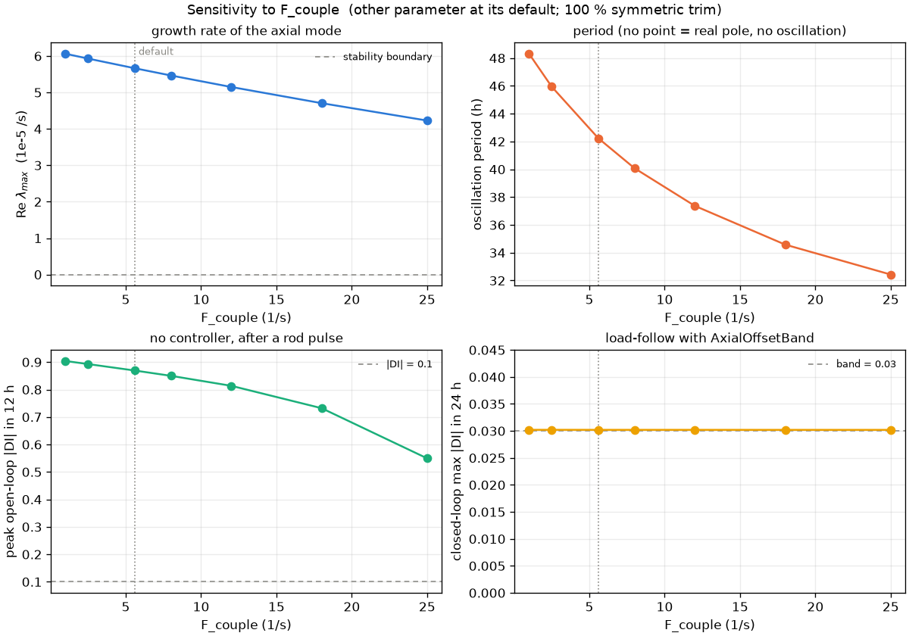
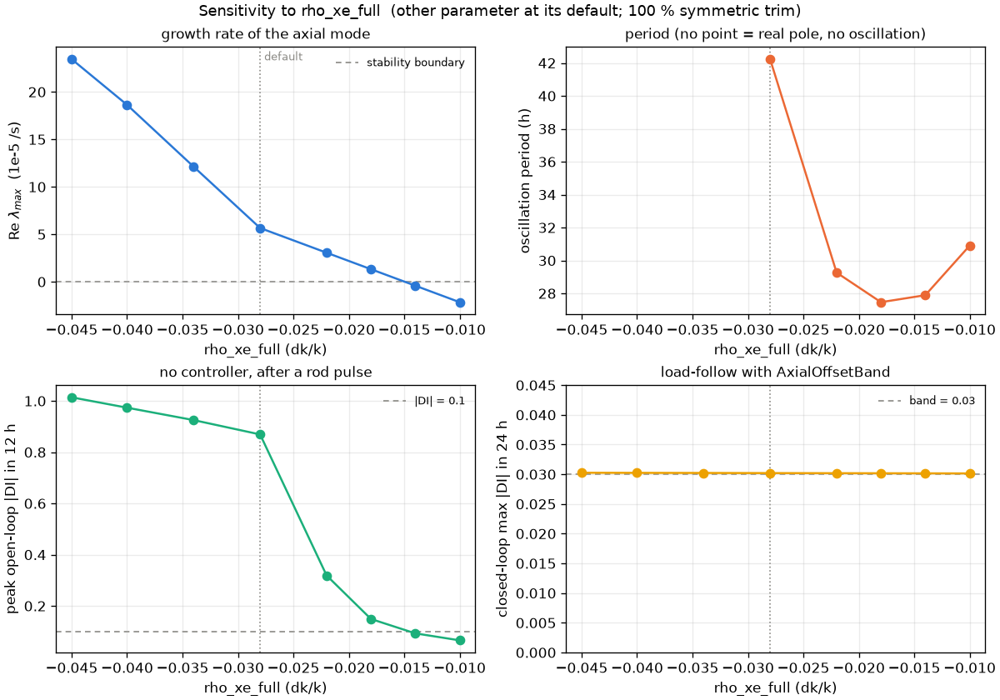

# Sensitivity to the two free parameters

`F_couple` (axial diffusion coupling) and `rho_xe_full` (xenon worth at
full-power equilibrium) come from neither source paper. This file reports what
happens to the axial behaviour when each is varied, and which statements
elsewhere in the docs depend on the values chosen.

Measured 2026-11-14 with `studies/sensitivity.py`. Every number below is in
[`studies/sensitivity_results.csv`](../studies/sensitivity_results.csv).

## Summary

- **`rho_xe_full` decides whether the axial instability exists.** Below a
  magnitude of about 0.0149 Δk/k the axial mode is stable; above about
  0.0315 Δk/k it diverges monotonically instead of oscillating. The default,
  −0.028, lies between the two.
- **`F_couple` changes the numbers but not the behaviour.** Across a 25× range
  the mode stays unstable and oscillatory.
- **`AxialOffsetBand(band=0.03)` held `DI` at every point tested.** Maximum
  `|DI|` over a 24 h load-follow was between 0.0301 and 0.0303 at all 15
  parameter values.
- **The period, the growth rate and the time for a tilt to grow are specific to
  the default pair.** See
  [What depends on the parameter values](#what-depends-on-the-parameter-values).

## Method

One parameter is swept at a time with the other at its default.

```python
F_GRID  = [1.0, 2.5, 5.6, 8.0, 12.0, 18.0, 25.0]                             # 1/s
XE_GRID = [-0.010, -0.014, -0.018, -0.022, -0.028, -0.034, -0.040, -0.045]   # dk/k
```

At each value, four things are measured:

1. **Trim invariance (a guard).** Trim at 100 %, `di_target=0`, and require the
   state to match the default trim to 1e-12. The script stops if this fails.
2. **Linear mode.** `linearize` at that trim (central finite differences,
   scaled); the rightmost eigenvalue with `|λ| > 1e-12`, which excludes the
   structural integrators at zero.
3. **Open-loop tilt.** The bare plant with no controllers at all. A 30 s pulse of
   +10 spm on `vrod_M` and −10 spm on `vrod_AO` sets an initial tilt, then the
   run continues to 12 h. `ClosedLoop.run` defaults (LSODA, `rtol=1e-7`,
   `atol=1e-9`) with `max_step=10` s so the pulse is not stepped over.
4. **Closed-loop cost.** `turbine_leading` with `ramp(1.0, 0.5, hold=4*3600)`
   and `AxialOffsetBand(band=0.03)` for 24 h, same solver defaults, 6000 output
   points. Rod travel is `∫(|vrod_M| + |vrod_AO|) dt` by trapezoid on those
   output points, converted from steps per minute to steps.

The two transitions in `rho_xe_full` are located by bisection on the linear
mode, to a resolution of about 1e-5 Δk/k.

The full run takes about 50 s (Python 3.14.6, numpy 2.5.3, scipy 1.18.1). All 30
time-domain runs reached their end time.

```bash
python studies/sensitivity.py
```

`--quick` runs the trim guard and the linear mode only and writes no files.
`--F-couple FLOAT` and `--rho-xe FLOAT` measure a single point and print it.
These flags are on this script and not on `validation/validate_vajpayee.py`
because the validation builds its plant with `two_point=False, xenon=False`,
which switches both parameters off.

## Results

### Trim invariance

The maximum state difference from the default trim was exactly 0.0 at all 15
values. Every difference below is therefore dynamics, not a moved operating
point.

### `F_couple`, with `rho_xe_full = −0.028`

| `F_couple` (1/s) | rightmost eigenvalue (1/s) | doubling (h) | period (h) | open-loop `\|DI\|` at 6 h | peak in 12 h | closed-loop max `\|DI\|` | rod travel (steps) |
|---|---|---|---|---|---|---|---|
| 1.0 | +6.063e-5 ± 3.612e-5j | 3.18 | 48.3 | 0.72 | 0.90 | 0.0302 | 709 |
| 2.5 | +5.930e-5 ± 3.798e-5j | 3.25 | 45.9 | 0.67 | 0.89 | 0.0302 | 709 |
| **5.6** | **+5.665e-5 ± 4.133e-5j** | **3.40** | **42.2** | **0.58** | **0.87** | **0.0302** | **708** |
| 8.0 | +5.467e-5 ± 4.355e-5j | 3.52 | 40.1 | 0.52 | 0.85 | 0.0302 | 708 |
| 12.0 | +5.150e-5 ± 4.670e-5j | 3.74 | 37.4 | 0.45 | 0.81 | 0.0302 | 707 |
| 18.0 | +4.706e-5 ± 5.047e-5j | 4.09 | 34.6 | 0.37 | 0.73 | 0.0302 | 706 |
| 25.0 | +4.229e-5 ± 5.382e-5j | 4.55 | 32.4 | 0.30 | 0.55 | 0.0302 | 705 |

Unstable and oscillatory at every value.



### `rho_xe_full`, with `F_couple = 5.6`

| `rho_xe_full` (Δk/k) | rightmost eigenvalue (1/s) | character | doubling (h) | period (h) | open-loop `\|DI\|` at 6 h | peak in 12 h | closed-loop max `\|DI\|` | rod travel (steps) |
|---|---|---|---|---|---|---|---|---|
| −0.010 | −2.147e-5 ± 5.648e-5j | stable | — | 30.9 | 0.07 | 0.07 | 0.0301 | 569 |
| −0.014 | −4.095e-6 ± 6.257e-5j | stable | — | 27.9 | 0.09 | 0.09 | 0.0302 | 597 |
| −0.018 | +1.327e-5 ± 6.354e-5j | unstable, oscillatory | 14.5 | 27.5 | 0.14 | 0.15 | 0.0302 | 626 |
| −0.022 | +3.063e-5 ± 5.964e-5j | unstable, oscillatory | 6.29 | 29.3 | 0.24 | 0.32 | 0.0302 | 659 |
| **−0.028** | **+5.665e-5 ± 4.133e-5j** | **unstable, oscillatory** | **3.40** | **42.2** | **0.58** | **0.87** | **0.0302** | **708** |
| −0.034 | +1.213e-4 (real) | unstable, monotonic | 1.59 | — | 0.90 | 0.93 | 0.0302 | 769 |
| −0.040 | +1.864e-4 (real) | unstable, monotonic | 1.03 | — | 0.97 | 0.97 | 0.0302 | 843 |
| −0.045 | +2.345e-4 (real) | unstable, monotonic | 0.82 | — | 1.01 | 1.01 | 0.0303 | 921 |

The rod pulse leaves `|DI|` ≈ 0.034 in every case, so the open-loop columns all
start from the same tilt.



### Transitions in `rho_xe_full`

| transition | lies between | resolution |
|---|---|---|
| stability boundary, `Re(λ) = 0` | −0.01494 and −0.01495 | ~1e-5 |
| complex pair meets the real axis | −0.03150 and −0.03152 | ~1e-5 |

Both are at the symmetric 100 % trim with the default `F_couple`. The default
−0.028 is 1.87 times the stability boundary and 11 % short of the
oscillatory-to-monotonic transition.

`Plant.__init__` warns when `|rho_xe_full|` is below `XE_STABILITY_WARN = 0.015`,
which is the measured boundary rounded up.

## What depends on the parameter values

### Whether the axial mode is unstable

Unstable across the whole `F_couple` grid, and for `rho_xe_full` at −0.018 and
beyond. **Stable at −0.010 and −0.014**, where an initial tilt of 0.034 never
exceeds 0.1.

### How fast an uncorrected tilt grows

Starting from `|DI|` ≈ 0.034, the default reaches 0.58 at 6 h and peaks at 0.87
inside 12 h. `|DI|` passes 0.9 by 6 h only for `rho_xe_full` of −0.034 and
beyond. These times depend on the size of the initial tilt; a larger one gets
there sooner.

### Whether `AxialOffsetBand(band=0.03)` holds the band

**Holds at all 15 values.** Maximum `|DI|` was 0.0301 to 0.0303 everywhere.
`DI` does go outside 0.03 at every value, by at most 0.0003: the controller acts
only on the excursion beyond the band, so some excursion is how it works.

The cost changes with `rho_xe_full`: rod travel over the 24 h rises from 569
steps at −0.010 to 921 at −0.045 (708 at the default). It is flat in `F_couple`
(705 to 709).

This is one load profile and one controller tuning. It does not show that the
band controller copes with any demand.

### The oscillation period

**The 42 h period is specific to the default pair.** It spans 32.4 to 48.3 h
across the `F_couple` grid and 27.5 to 42.2 h across the oscillatory part of the
`rho_xe_full` grid. Beyond about −0.0315 there is no period at all.

### Which parameter matters more

`rho_xe_full`. A 25× change in `F_couple` moves the doubling time by a factor of
1.43 and changes nothing qualitative. A 4.5× change in `rho_xe_full` takes the
mode from stable through oscillatory to monotonic.

## What this does not establish

- **It is local.** One operating point: 100 % power, symmetric, every other
  parameter at its default. The linear results say nothing about part load, and
  the stability boundary has not been located anywhere else.
- **It is one-at-a-time.** The two parameters were never varied together, so any
  interaction between them is unmeasured.
- **It says nothing about which values are right.** The sweep shows what the
  model does for a given value. Whether 5.6 1/s or −0.028 Δk/k describes any
  real plant is a separate question that this study cannot answer.
- **The open-loop times depend on the initial tilt**, which was a single fixed
  rod pulse.
- **The closed-loop result is one transient** with the shipped controller gains.
